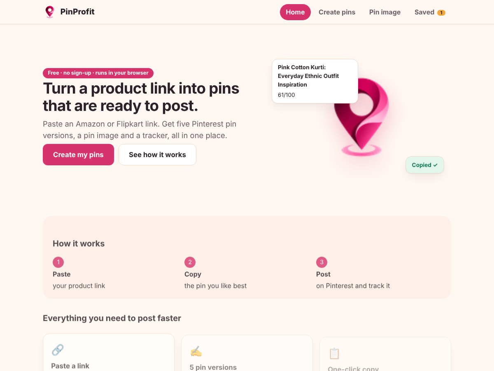
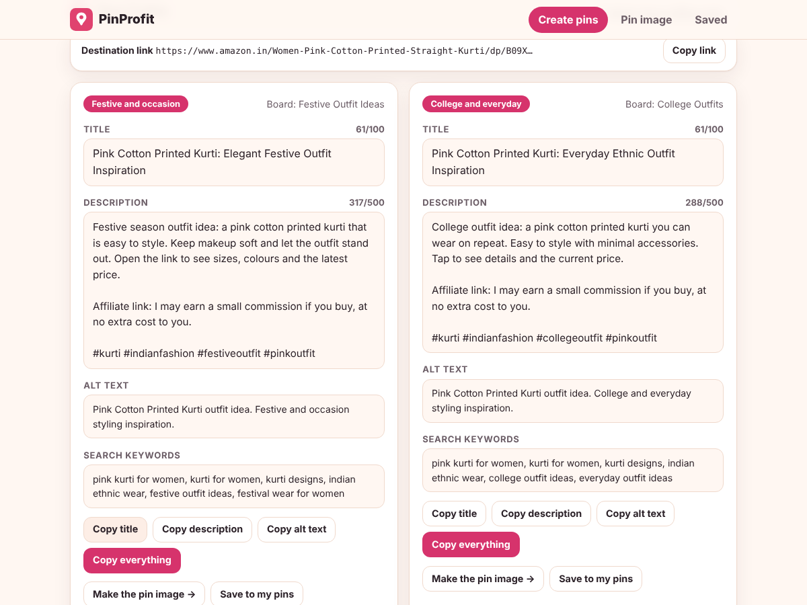
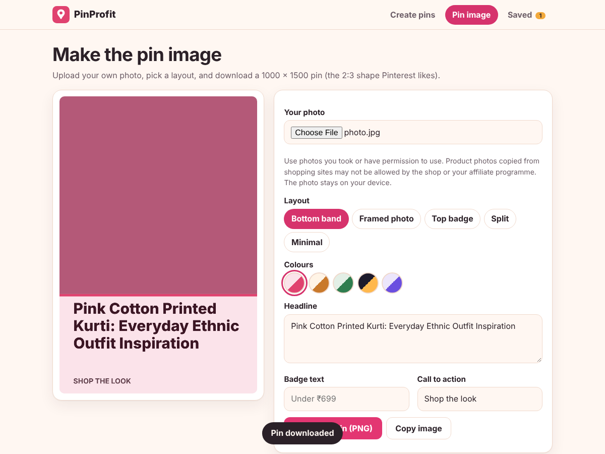
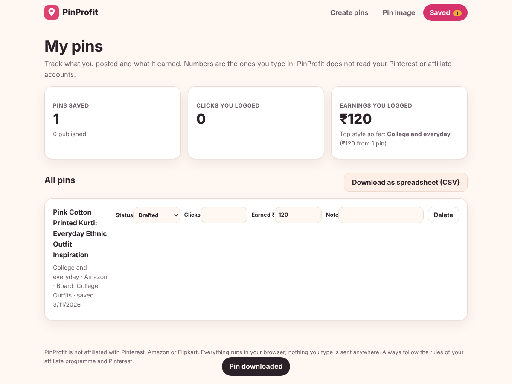

# PinProfit

Paste an Amazon or Flipkart product link and get 5 ready-to-post Pinterest pin versions (title, description, hashtags, alt text, board, keywords) with one-click copy. Then make the pin image from your own photo, and track what each pin earns.

## Honest by design
- First-time setup asks if you have an Amazon Associates account (links to signup if not). Once you save your ID, it is added to plain product links automatically; never over an existing tag, never on short links. Check the first link in your affiliate reports. Switch to "paste my own official link" any time.
- No AI and no scraping: the product name comes from the link text; you add colour, details and price.
- Price appears only if you type it, as "Under ₹X at the time of posting".
- The link checker only says an affiliate tag is **present**, never "verified".
- Affiliate disclosure is added to each description (you can edit it).
- Everything is stored in your browser (localStorage). Nothing is uploaded.

Pinterest limits: title up to 100 characters, description up to 800 (about 500 reads best), alt text up to 500.

## Run / test
Static site, no build. `node tests/unit.js` (30) and `python3 tests/e2e.py` (64, needs Playwright).
Deploy on Vercel: Framework "Other", no build command.

## Also included
- Many links at once: paste up to 20 links, get a pin for each, copy or save them all.
- Posting plan: spreads saved pins across days (1 to 5 per day), copy a whole day, mark pins as posted.
- Colour mode switch: Auto (follows your phone), Light or Dark, remembered on the device.
- Installable on a phone (Add to Home Screen) and works offline after the first visit.
- Weekly earnings chart (by the week each pin was saved, using only numbers you typed).
- Backup and restore: download a JSON file, restore it on another device. Imports are validated and cleaned.
